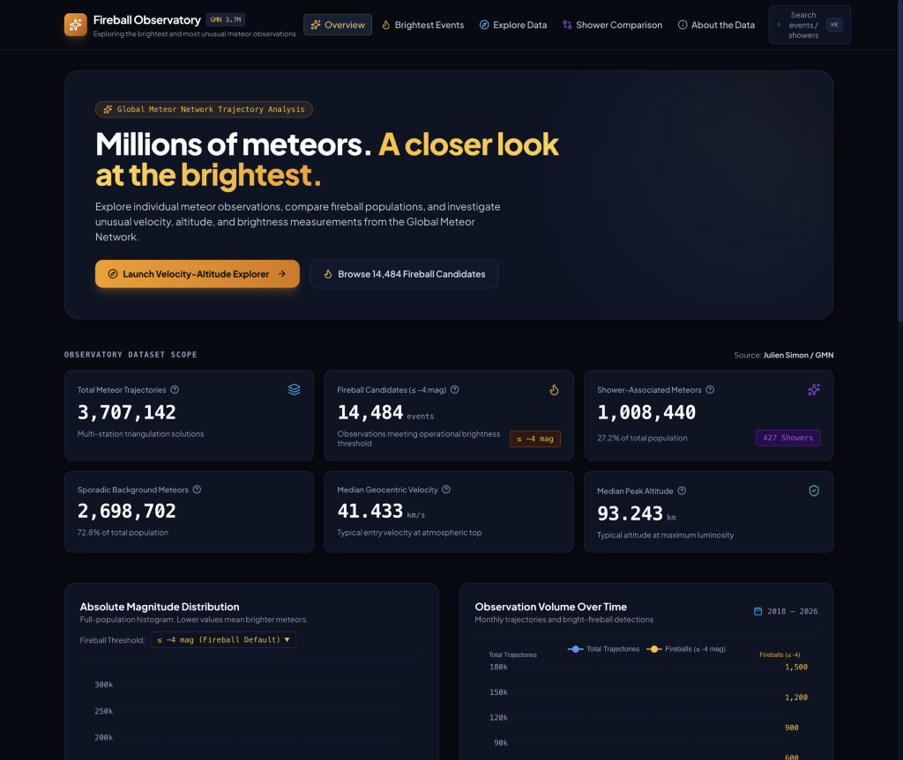
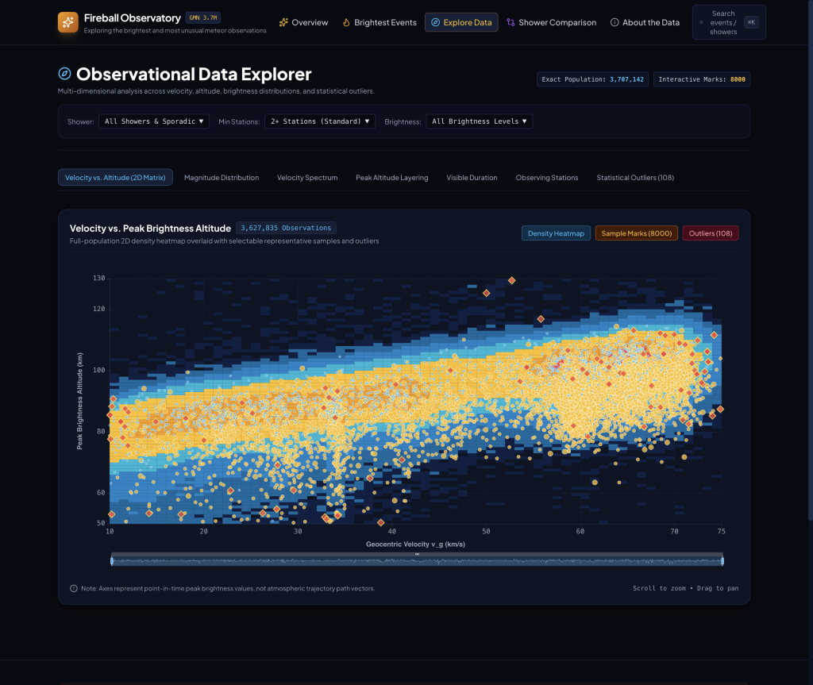
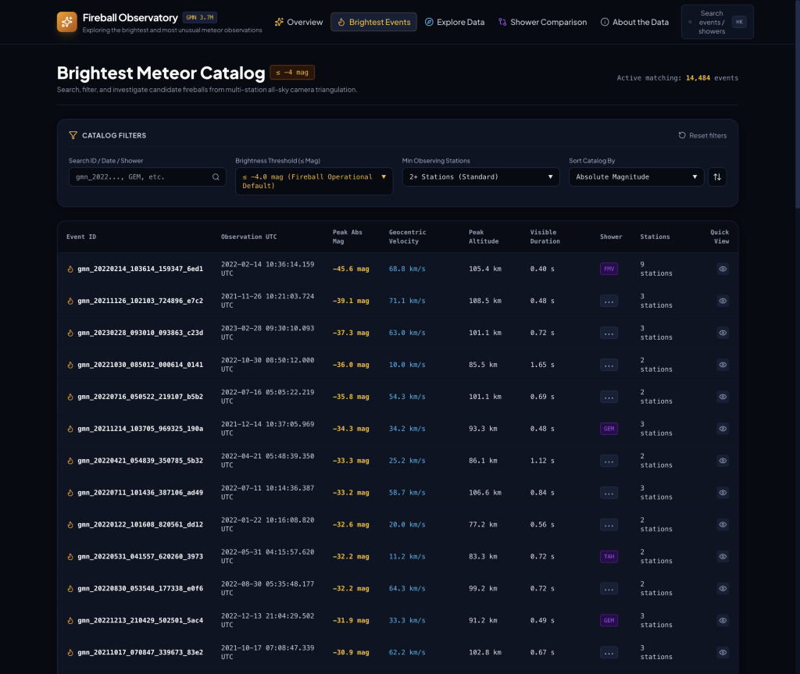
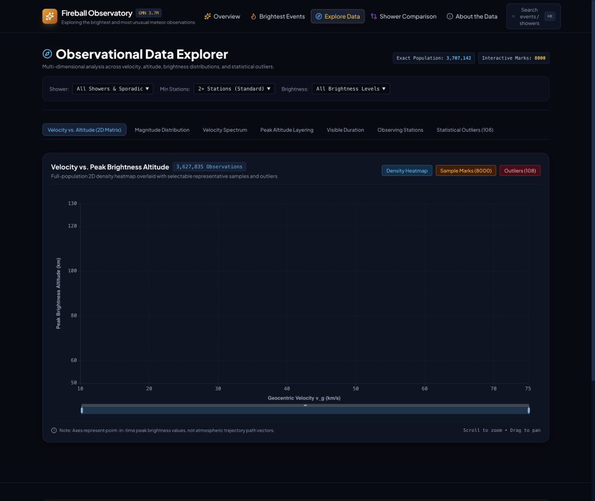
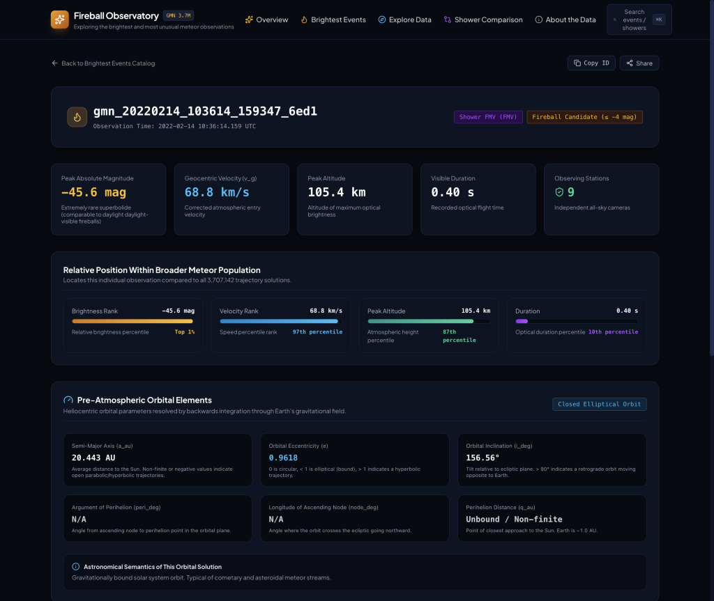

# Fireball Observatory

[](https://github.com/ranajahanzaib/fireball-observatory/actions/workflows/ci.yml)
[](./LICENSE)
[](https://creativecommons.org/licenses/by/4.0/)
[](https://www.typescriptlang.org/)
[](https://react.dev/)
[](https://www.rust-lang.org/)
[](https://workers.cloudflare.com/)

> **Exploring the brightest and most unusual meteor observations.**
> An interactive astronomical research and exploration platform analyzing **3,707,142 meteor trajectory solutions** from the [Global Meteor Network (GMN)](https://globalmeteornetwork.org), curated by Julien Simon under Creative Commons Attribution 4.0.



---

## Observational Overview

**Fireball Observatory** is an open-source astronomical analysis application that brings big-data meteor science into an interactive, high-performance web experience. Rather than treating meteor observations as simple points on a map, Fireball Observatory provides deep analytical access to multi-station stereoscopic camera trajectories, orbital dynamics, atmospheric ablation layers, and population statistics.

---

## Visual Showcase

| Observatory Dashboard & Population Metrics | 2D Velocity vs. Altitude Ablation Heatmap |
| :---: | :---: |
| [](docs/screenshots/overview.png) | [](docs/screenshots/velocity-altitude-explorer.png) |
| *Real-time statistics across 3.7M+ events, temporal flux trends, and magnitude distributions.* | *Interactive logarithmic density bins and scatter overlays of cometary vs. asteroidal meteors.* |

| Brightest Fireballs Catalog & Bolide Filtering | Meteor Shower Kinematics & Velocity Comparison |
| :---: | :---: |
| [](docs/screenshots/fireballs-catalog.png) | [](docs/screenshots/shower-comparison.png) |
| *Configurable absolute magnitude thresholds ($M_{abs} \le -4.0$), multi-station filters, and sorting.* | *Comparative velocity distributions and ablation profiles across 427 IAU showers and sporadic background.* |

| Individual Event Trajectory & 3D Orbital Elements |
| :---: |
| [](docs/screenshots/event-detail.png) |
| *Deep inspection of multi-station triangulation parameters, Keplerian elements ($a, e, i, \omega, \Omega, q$), and population percentile gauges.* |

---

### Key Capabilities

- **Observatory Dashboard (`/`):** Real-time key astronomical metrics across 3.7+ million events, temporal timeline trends, monthly observation frequencies, and interactive distribution histograms for magnitude, altitude, velocity, and duration.
- **Brightest Fireballs Catalog (`/fireballs`):** Dedicated catalog for luminous bolides and superbolides. Features a **configurable brightness threshold** (defaulting to operational $M_{abs} \le -4.0$, adjustable to $-3.0$, $-5.0$, $-6.0$, or custom), multi-station filter toggles, shower filters, and instant quick-inspection drawers.
- **2D Trajectory Explorer (`/explore`):** Accelerated 2D density heatmap and scatter visualization comparing **geocentric entry velocity ($v_g$) against peak brightness altitude ($H_{peak}$)**. Explores physical ablation regimes from slow asteroidal penetrations ($< 60\text{ km}$) to hypervelocity cometary grazers ($> 100\text{ km}$).
- **Meteor Shower Comparison (`/showers`):** Deep comparative analysis across **427 IAU recognized showers** and sporadic background meteors (`...`). Compare velocity envelopes, radiant positions, retrograde inclinations, and fireball fractions between Geminids (`GEM`), Perseids (`PER`), Orionids (`ORI`), Quadrantids (`QUA`), and others.
- **Individual Event Permalinks (`/events/:eventId`):** Deep inspection for any meteor event using deterministic URL-safe identifiers (e.g. `/events/gmn_20220214_012642_123456_a1b2`). Inspect stereoscopic triangulation parameters, 3D Keplerian orbital elements ($a, e, i, \omega, \Omega, q$), physical ablation statistics, and population percentile gauges.
- **Unusual Outlier Analysis:** Curated scientific filters for physical and statistical anomalies: extreme superbolides, deep mesospheric penetration ($H \le 50\text{ km}$), hypervelocity solutions ($v_g \ge 72\text{ km/s}$), and ultra-long duration Earth-grazers ($\Delta t \ge 4.0\text{ s}$).
- **Data Provenance & Methodology (`/about`):** Complete transparent accounting of data lineage, camera triangulation mechanics, mathematical definitions, and observational limitations.

---

## System Architecture

Fireball Observatory is built for zero-cost, high-scale Cloudflare serverless delivery:

```
┌─────────────────────────────────────────────────────────────────────────────┐
│                             OFFLINE PIPELINE                                │
│                                                                             │
│  Hugging Face GMN Dataset       Rust Pipeline Binary (`fireball-pipeline`)  │
│  [294 MB Parquet, 3.7M rows] ──▶ Ingestion, Precomputation, Partitioning   │
│                                           │                                 │
│                                           ▼                                 │
│                     ┌─────────────────────────────────────┐                 │
│                     │       Precomputed Artifacts         │                 │
│                     │  - Manifest with SHA-256 Checksums  │                 │
│                     │  - 1D Distributions (Histograms)    │                 │
│                     │  - 2D Velocity-Altitude Heatmap     │                 │
│                     │  - Fireball & Outlier Catalogs      │                 │
│                     │  - Daily Compressed Partitions (.gz)│                 │
│                     └─────────────────────────────────────┘                 │
└──────────────────────────────────────┬──────────────────────────────────────┘
                                       │
                                       ▼ Deploy / Sync
┌─────────────────────────────────────────────────────────────────────────────┐
│                           EDGE DELIVERY TIER                                │
│                                                                             │
│   Cloudflare R2 Object Storage      Cloudflare Workers & Static Assets      │
│   (Persistent Analytical Bucket)    - Edge Caching (stale-while-revalidate) │
│                                     - Native Range & Content-Encoding Gzip  │
│                                     - Zero request-time table scans         │
└──────────────────────────────────────┬──────────────────────────────────────┘
                                       │
                                       ▼ HTTP/2 + Streaming
┌─────────────────────────────────────────────────────────────────────────────┐
│                              CLIENT BROWSER                                 │
│                                                                             │
│   React 19 SPA (Vite + TypeScript + Tailwind CSS + Apache ECharts)          │
│   - Streams precomputed JSON & gzipped daily event partitions               │
│   - Client-side Web Streams API (`DecompressionStream('gzip')`)             │
│   - Instant client-side filtering, percentile gauging, and astronomical math │
└─────────────────────────────────────────────────────────────────────────────┘
```

### Why Precomputed Artifacts?

- Loading a 294 MB Parquet dataset or scanning 3.7 million records in a Cloudflare Worker on every request violates Worker execution memory (128 MB) and CPU limits.
- Full analytical relational tables with indexes exceed Cloudflare D1's 500 MB Free-plan limit.
- Deterministic offline precomputation in Rust processes the entire dataset in **~6.4 seconds**, generating optimized JSON distributions and daily compressed event partitions (`.json.gz`).
- Individual event lookups stream small daily partitions on demand (averaging 8–30 KB) decompressed client-side via `DecompressionStream('gzip')`.

---

## Repository Structure

```text
fireball-observatory/
├── apps/
│   └── web/                     # Vite + React 19 + TypeScript + Tailwind SPA
│       ├── src/
│       │   ├── api/             # Typed data fetchers & Web Stream decompressors
│       │   ├── components/      # UI components (Header, Footer, Layout, StatCards)
│       │   │   └── charts/      # Apache ECharts (Heatmap, Histograms, TimeSeries)
│       │   ├── routes/          # Application pages (Overview, Fireballs, Explore, etc.)
│       │   └── test/            # React Testing Library & Vitest test suites
│       └── public/data/         # Local copy of precomputed data artifacts
├── packages/
│   └── shared/                  # Shared TypeScript schemas, IAU tables, astro helpers
├── worker/                      # Cloudflare Worker for static asset & R2 streaming
│   ├── src/                     # Edge request handlers, CORS, and cache controls
│   └── wrangler.jsonc           # Worker and R2 binding configuration
├── data-pipeline/               # High-performance Rust CLI for analytical ingestion
│   ├── src/                     # Parquet reader, Arrow processing, partitioning, stats
│   └── tests/                   # Rust pipeline unit and roundtrip tests
├── data/
│   ├── raw/                     # Original Parquet dataset (gmn_meteors.parquet)
│   ├── fixtures/                # 10,000-row fixture for fast local and CI testing
│   └── processed/               # Emitted precomputed analytical artifacts
├── scripts/
│   ├── download-dataset.sh      # Downloads official Parquet dataset from Hugging Face
│   ├── build-dataset.sh         # Runs Rust precomputation and syncs to web
│   ├── verify-dataset.sh        # Cryptographic SHA-256 manifest verification
│   └── upload-to-r2.sh          # Uploads artifacts to Cloudflare R2 bucket
├── docs/
│   ├── architecture.md          # Cloudflare serverless edge architecture
│   ├── data-dictionary.md       # Complete column semantics, units, and orbital math
│   ├── deployment.md            # Step-by-step production deployment instructions
│   └── scientific-notes.md      # Outlier detection, ablation physics, triangulation
└── .github/workflows/
    └── ci.yml                   # Automated Rust, TypeScript, and unit test CI
```

---

## Getting Started

### Prerequisites

- **Node.js:** v20 or v22 LTS
- **pnpm:** v10 or later
- **Rust:** v1.80+ (`cargo`)

### 1. Installation

```bash
git clone https://github.com/ranajahanzaib/fireball-observatory.git
cd fireball-observatory
pnpm install
```

### 2. Prepare Data (Quick Fixture or Full Dataset)

For rapid local testing and development, a verified 10,000-event fixture is included in `data/fixtures/sample_meteors.parquet`.

To build the full 3.7-million-record dataset:

```bash
# 1. Download official GMN Parquet file (~294 MB)
pnpm run data:download

# 2. Ingest, precompute distributions, and partition events
pnpm run data:build

# 3. Verify SHA-256 checksums across all generated artifacts
pnpm run data:verify
```

### 3. Start Local Development Server

```bash
pnpm run dev
```

Visit [http://localhost:3000](http://localhost:3000) in your browser.

---

## Verification & Testing

The repository includes end-to-end verification across the Rust pipeline, shared TypeScript domain packages, the Cloudflare edge worker, and the React 19 web application:

```bash
# TypeScript typechecking across shared, web, and worker
pnpm run typecheck

# Execute all Vitest test suites (React components, Worker, shared helpers)
pnpm run test

# Execute Rust data pipeline tests
cargo test --manifest-path data-pipeline/Cargo.toml

# Production bundle compilation
pnpm run build

# Cryptographic SHA-256 data artifact verification
bash scripts/verify-dataset.sh
```

### Verified Astronomical Dataset Metrics

When built from the official Global Meteor Network Parquet release (`gmn_meteors.parquet`), the Rust pipeline deterministically validates and generates:
- **Total Ingested Trajectories:** `3,707,142` stereoscopic observations
- **Cataloged Fireballs ($M_{abs} \le -4.0$):** `14,484` bolides and superbolides
- **Documented Meteor Showers:** `427` IAU shower groups + Sporadic background (`2,698,702` meteors, 72.8%)
- **Precomputed Artifacts:** 1 manifest (`manifest.json`), 6 distribution matrices, 2 catalogs, and 2,058 daily compressed event partitions (`.json.gz`), all cryptographically verified by SHA-256 checksums.

---

## Data Source & Attribution

Data courtesy of the **Global Meteor Network (GMN)**:

- **Curated Dataset:** [Hugging Face: juliensimon/global-meteor-network](https://huggingface.co/datasets/juliensimon/global-meteor-network)
- **Original Curator:** Julien Simon
- **License:** [Creative Commons Attribution 4.0 International (CC BY 4.0)](https://creativecommons.org/licenses/by/4.0/)
- **Network Coordinates:** [Global Meteor Network](https://globalmeteornetwork.org)

_Attribution Notice:_ Trajectory solutions are computed by GMN using multi-station optical triangulation from volunteer all-sky cameras worldwide. Absolute magnitudes represent optical brightness normalized to 100 km at zenith.

---

## License

This project is open-source software licensed under the [MIT License](./LICENSE). The underlying meteor observation dataset is licensed under [CC BY 4.0](https://creativecommons.org/licenses/by/4.0/).
